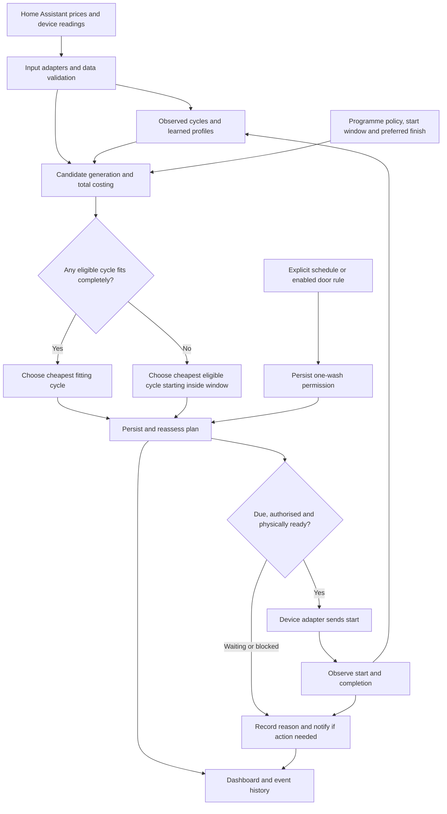

# Load Optimizer: architecture and delivery plan

Planning baseline: 3 November 2026. This records the architecture review and user decisions; it does not claim that proposed behaviour has been implemented or deployed.

## Goal

Use observed device consumption and tariff analysis to automate useful appliance runs and EV charging at the best estimated total financial benefit. Explain the selected plan and its outcome. Start with Octopus inputs and independent devices; broader suppliers and household-wide coordination are outside the immediate delivery scope.

## Agreed behaviour

### Normal dishwasher washing

- An explicit scheduling request authorises exactly one normal wash. It does not authorise extra profitable runs.
- The optimiser chooses timing and programme from the configured eligible programmes.
- Prefer a cycle that starts and finishes inside the selected window. Among fitting options, select the cheapest eligible cycle.
- If none fits completely, select the cheapest eligible cycle whose start is inside the window, even if completion falls after the window.
- Never move the start outside the selected window to chase a cheaper price. In particular, an overnight request must not become an unplanned midday run.
- A late finish does not authorise interruption of an active wash.
- The preferred completion time is configurable; this household's value is 07:00.
- The default overnight start window is 21:00–07:00 in the household timezone. A fallback may finish after 07:00, but its start must remain inside that window.
- Door-based authorisation is an optional setting, off by default. When enabled, an observed opening lasting at least the configurable threshold followed by closure can authorise one normal wash. The household threshold is two minutes.
- Door duration is a readiness heuristic, not proof of dirty dishes. Startup/restored state must not manufacture permission.
- Explicit scheduling does not require a qualifying door opening. Physical readiness checks still apply.
- Cancellation clears pending normal-wash permission and its plan; it does not stop an active wash or disable the separate opportunistic mode.
- Normal washing takes priority over opportunistic runs.

### Prices and financial evaluation

- Prices are expected to be available. Missing required price coverage triggers an action-needed notification.
- Missing prices must not be interpreted as free electricity. The late-finish fallback requires prices covering the entire candidate cycle, including the portion after the window.
- Do not silently extend the authorised start window while waiting for prices.
- If complete prices return while an eligible start remains inside the original window, automatically resume planning and execution under the existing permission. Do not require a second scheduling request. Cancellation or expiry prevents resumption.
- Evaluate electricity plus configured water, consumables and wear costs. Unspecified additional operating costs count as zero and remain visibly unconfigured; this convention does not apply to missing tariff data.
- Any strictly positive estimated net benefit can qualify an independently authorised opportunistic run. Rank usable extra runs by highest net benefit per run; programme priority breaks ties. A current usable opportunity retains precedence over future opportunities.
- Reassess unstarted plans as inputs change, retaining the agreed short pre-start freeze. Do not interrupt running cycles to chase savings.
- Keep routine decisions and outcomes in event history. Notify when action is needed. A routine pre-wash announcement is a separate optional feature.

### EVs and scope

- Required mode aims to reach a configured target by a deadline and may use paid electricity.
- Opportunistic mode charges within a configured price ceiling without promising a target by a deadline.
- EV planning and EV control are separate delivery milestones. Current repository documentation describes advisory EV planning.
- Keep device plans independent in the present scope.

## Architecture

Permission, recommendation, queued execution and observed physical outcomes must remain separate records. A recommendation cannot create authority; sending a command cannot establish a successful start.

Suggested request states are awaiting plan, scheduled, starting, running, completed, cancelled, expired and blocked. A normal request owns one wash across replanning and restarts. Execution must prevent duplicate starts and confirm device state before consuming permission. Confirmation ambiguity must be reconciled before a retry.

Record the permission source, request identity, absolute window bounds with timezone, preferred finish, selected programme, expected start/finish, estimated cost breakdown, fallback reason, execution attempts and actual outcome. Show a late finish clearly without treating an agreed fallback as an error requiring routine notification.

Missing tariff coverage is a data failure, not a reason to invoke the window fallback. No eligible start inside the window means no authorised plan. The handling of an expired request must never create an automatic request for the next day.

## Delivery milestones

| Milestone | Deliverable | Acceptance |
| --- | --- | --- |
| 1. Behaviour and implementation baseline | Reconcile agreed rules with code, installed version and release documentation. Identify implemented, validated, deployed and proposed capabilities separately. | Each request and failure case has a specified outcome; discrepancies have an owner and delivery step. |
| 2. Reliable dishwasher scheduling | Explicit schedule/start/cancel, optional door permission, configurable window and preferred finish, late-finish fallback, persisted one-wash request. | A request survives restart and replanning, starts at most once within its window, and records actual outcome. Missing prices notify. Cancellation cannot requeue from old permission. |
| 3. Trustworthy total-benefit decisions | Profile-based electricity costing, additional operating costs, normal-run priority and separately authorised opportunistic runs. | Known examples calculate correct total costs and positive net benefit; opportunistic runs cannot displace a requested wash. |
| 4. Usable controls and explanations | Dashboard, clear late-finish explanation, event history and action-needed notifications. | A household user can inspect, accelerate or cancel a plan and understand its result without internal diagnostics. |
| 5. Required and opportunistic EV planning | Explicit charging modes with targets, deadlines, price ceilings and shortfall explanations. | Plans handle target changes, connection changes, new prices and insufficient charging opportunities correctly. |
| 6. Optional EV control | Supported charger adapter, explicit activation, state confirmation and recovery. | Actual charging follows the authorised plan with no duplicate commands or unsafe retries. |
| 7. Repeatable public installation | Guided configuration, consistent versioned documentation and release acceptance. | A fresh installation reaches a learned cycle and a successful scheduled run using the published guide. |

Milestones 1–4 form the first complete delivery: dependable dishwasher optimisation. Documentation and onboarding should improve throughout; milestone 7 verifies the complete installation journey. These are outcome gates, not estimated dates or new release commitments.

## Implementation sequence

1. Map current scheduling, costing, persistence and control code to the agreed behaviour; inspect installed and branch versions separately.
2. Define a normal-wash request independently of the current recommendation, including its fixed start window and preferred finish.
3. Add explicit optional door-based authorisation without weakening explicit requests or physical safety checks.
4. Generate fully priced eligible candidates starting inside the window. Prefer complete fits; otherwise rank late-finishing candidates by total cost.
5. Persist the request and plan; support re-evaluation, cancellation, expiry and restart reconciliation.
6. Execute only within the original start window, rechecking authority, programme eligibility, current data and physical readiness immediately before the command.
7. Confirm running state, monitor outcome and update learning. Retain failed or ambiguous attempts separately from completed runs.
8. Verify total-benefit calculations and normal-versus-opportunistic priority.
9. Expose controls, decision reasons and action-needed alerts; complete the dishwasher acceptance journey.
10. Apply shared pricing and policy concepts to EV planning, then deliver charger control through its own adapter and acceptance gate.

## Representative acceptance cases

- A cheaper programme misses the preferred finish while another fits: choose the cheapest fitting option.
- No eligible programme finishes in time: choose the cheapest fully priced eligible option starting inside the window and show its later finish.
- An outside-window start is cheaper: reject it.
- Prices end at the window boundary but a fallback continues beyond it: do not price the unknown tail as zero; notify about missing coverage.
- Prices are unavailable: notify; no unpriced automatic start.
- Complete prices return before the window closes: automatically replan under the existing permission, retaining the original window and all execution checks.
- Prices return after expiry or cancellation: do not revive the request.
- Door-based authorisation is off: door activity creates no normal-wash permission.
- Door-based authorisation is on: threshold boundaries, interrupted telemetry and restored states behave as specified.
- Cancel, restart, repeated door closure and repeated scheduler ticks cannot duplicate a wash or recreate cancelled permission.
- Remote start is disabled or the door is open at the due time: retain the physical safety gate and record the reason; never move the start beyond the window.
- A profitable extra run conflicts with a normal wash: normal washing wins.
- A late-finishing wash crosses midnight or a daylight-saving boundary: cost using actual tariff intervals and preserve the authorised local-time intent.

## Initial evidence and limits

The initial review read the recent discussion in “Add EV smart charging integration”, README, architecture and roadmap documents, dishwasher-control and EV guides, repository status, and manifest. The manifest observed during review was 1.7.0-beta.9. The project was being edited by another active chat; working changes are not evidence of deployment or completed validation.

At the initial review, the dishwasher script guide required a ready recommendation and did not include the proposed household wake-up setting. The first development batch replaces those limitations and updates the high-level architecture. That implementation is separate from the installed or released product baseline.

Development has started in the isolated `load-optimizer` checkout in this workspace, on `feat/overnight-scheduling-milestones`, based on shared-beta commit `3184482`. The first batch implements durable normal-wash requests, native window controls, late-finish fallback, price-recovery notifications, normal-run priority and command-time revalidation. Existing door-based automatic mode remains an opt-in that is off by default.

No deployment or release has been performed. Installed-version verification and supervised physical-appliance acceptance remain outstanding. The second batch implements and validates total-cost precision, explicit consumables costs, unconfigured-cost disclosure, strictly positive extra-run eligibility and ranking by net benefit per run. Financial breakdown cards are included in both dashboard templates. The third batch delivers the initial scheduling controls and explanations: shared Next wash cards, explicit schedule/start/cancel controls, window settings, optional-mode labels, readable blockers and event descriptions, and distinct waiting, starting, washing and terminal states. Both EV milestones remain separate delivery work. Physical-appliance and desktop/mobile visual acceptance remain outstanding.

Local validation for this batch passed 513 unit tests, Bandit and all 20 isolated Home Assistant acceptance checks against Python 3.14.2 and Home Assistant 2026.10.2. The checks include price recovery, native time controls, one confirmed synthetic start, cancellation, restart persistence and a command sequence blocked when the start window closes. This is synthetic acceptance, not proof from a physical dishwasher.

## Total-benefit implementation acceptance

The second batch passed 529 unit tests, Bandit and all 20 isolated Home Assistant acceptance checks. Financial cases cover exact break-even, tiny positive returns, decimal cancellation across tariff periods, operating-cost changes before a command, free electricity without profit, positive-price normal washing and missing-cost disclosures. The full and beta dashboard cost templates render successfully with missing data and sub-penny benefits. No physical appliance was operated. See `docs/operating-costs.md` in the development checkout for configuration.

## Scheduling-interface implementation acceptance

The third batch passed 533 unit tests, Bandit and all 20 isolated Home Assistant acceptance checks. Template fixtures cover a missing-price permission with a retained old estimate, a queued late-finishing cycle, unconfirmed start commands, appliance-confirmed washing, cancellation and legacy missing-message data. Four dashboard actions and three optional scripts dispatch to their intended native buttons. The final window-guidance and legacy-message fallback refinements also passed the targeted Home Assistant dashboard check. No live installation or release was changed.

## Confirmed window and price recovery

The household's default overnight window begins at 21:00 and ends at 07:00. Missing prices trigger a notification. Complete prices returning in time allow automatic resumption inside the original window under the existing permission; they do not revive cancelled or expired requests.

## Selected first release scope — 6 November 2026

The user selected dishwasher scheduling and costs for the first release. This
candidate is based on `4606832`, containing milestones 1–4 and excluding the
later EV planning and automatic-control commits. Existing baseline advisory EV
behaviour remains; no new EV mode or control adapter is included.

The candidate adds complete two-version validation and source identity reports.
Physical dishwasher acceptance, desktop/mobile and unfamiliar-user walkthrough,
fresh installation and rollback remain required before publication. No version
was assigned, installation changed or release published. The broader development
branch and draft PR #26 retain the EV work independently.
