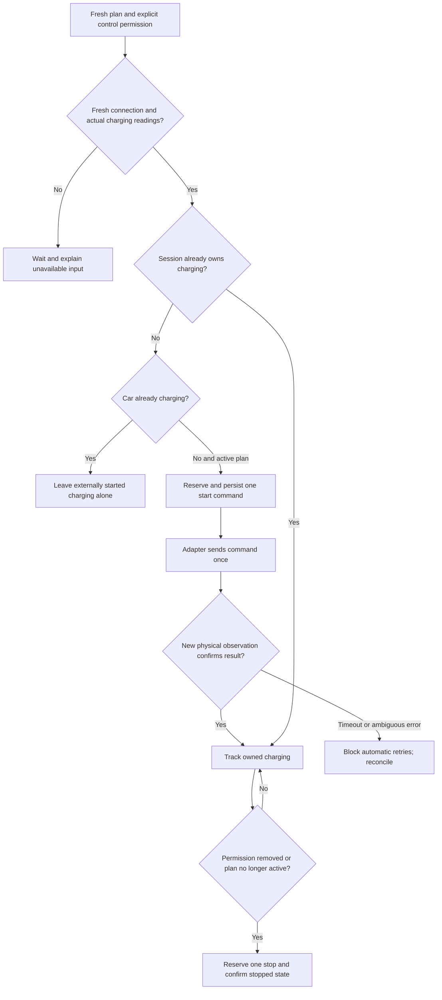

# Optional EV control: development foundation

Charger control is not yet connected to Home Assistant services or exposed as an
enable option. Existing EV entries remain advisory. Milestone 6 is in progress.

The household has identified `sensor.volvo_xc60_battery` as its battery-level
input and `switch.volvo_charger` as the switch controlling energy to the car.
These are user-supplied references, not verified live entities. The switch cuts
power when off. Do not assume that an on switch proves the car is plugged in or
charging. Battery units, usable capacity, charge power and efficiency still need
verification before setup.

## Control flow

`ev_control.py` implements the command lifecycle independently of hardware. It
reserves command identities, waits for post-command physical observations, blocks
retries after uncertain outcomes, quarantines restored sessions, and does not
claim externally started charging. An unexpected external stop blocks restarts
until explicit reconciliation. Removing permission during an unconfirmed start
waits for confirmation before requesting a stop. This avoids overlapping commands.

The model does not itself save state, schedule updates, notify, or call services.
Its caller must persist a checkpoint **before** dispatch; successful service
completion does not confirm charging. Fresh charging telemetry must be at most
60 seconds old, not from the future, and newer than the pending command when
confirming it. Connection freshness and fresh plan validation are adapter duties.
Explicit reconciliation must use a newly verified stopped reading.

## Remaining implementation steps

1. Identify connection and actual charging feedback entities and verify switch
   semantics, units, availability and update frequency. Decide whether power
   switching is suitable for this particular charger. Do not infer this from the
   entity name.
2. Implement an adapter for the verified switch and feedback signals. Check that
   configured entities exist and support their expected functions. Keep the
   battery entity separate from charger feedback.
3. Add a separate opt-in, off by default, with household-facing status, manual
   suspension and explicit reconciliation controls. Preserve current EV IDs.
4. Wire persistence-before-dispatch, source listeners and exact slot-boundary
   timers. Recalculate target, connection, prices and active interval immediately
   before each start. Do not let a stale charge-now snapshot operate the switch.
5. Test the full Home Assistant path with mocked switch services, confirmation
   loss, restart, disconnect, target reached, tariff loss and external overrides.
   Define a bounded recovery policy for unavailable telemetry; current model
   deliberately waits without sending unverified commands.
6. Complete supervised hardware acceptance separately from synthetic tests.
   Record actual start/stop feedback and remaining limits before marking
   milestone 6 complete. No live hardware was operated during foundation work.
