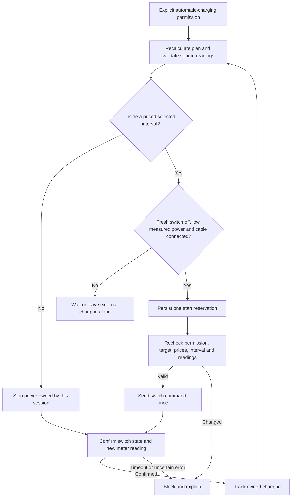

# Optional EV switch control (unreleased)

EV entries are advisory unless optional charger mappings are configured and the
separate **Automatic Charging** switch is turned on. Saving configuration never
turns it on. This development implementation has synthetic Home Assistant
acceptance; supervised hardware acceptance and release remain outstanding.

## Set up

1. Verify that switching power is suitable for your charger and identify its
   switch, measured power sensor and dedicated cable-connection sensor. A switch
   being on does not prove that the car is drawing power. A car's internet
   connectivity sensor does not prove that a charging cable is connected.
2. Edit the existing EV entry. Select the optional charger power switch and
   measured power sensor, plus the connection status entity. Select a car
   charging-status sensor only as additional feedback. Keep existing entries
   and IDs rather than recreating the integration.
3. Use future-rate entities for prices. For Octopus, select the current-day rates
   event as the primary tariff and its next-day event under Additional future-rate
   entities. Use gbp_per_kwh for value_inc_vat values. A current-rate-only sensor
   is insufficient. An empty tomorrow event does not erase today's usable slots
   or make tomorrow free. Missing coverage can leave a reported target shortfall.
4. Check the battery percentage, usable capacity, expected wall charging power,
   efficiency, mode, target and deadline. Observed wall power is evidence to
   review the expected-power setting, not permission to silently change it.
5. Inspect the EV Status entity or optional plan card. Restore unavailable inputs
   before activation. Configure a confirmation timeout between 30 and 600 seconds;
   the default is 180 seconds. One reviewed Volvo session took approximately
   66 seconds to report charging and 104 seconds to report idle, so a 60-second
   car-status timeout would be inadequate.
6. Turn on **Automatic Charging** only when ready for this entry to operate the
   configured power switch. It follows currently active, freshly recalculated
   slots, including useful required-mode partial plans. It leaves an already-on
   external power session alone. Turning permission off cuts power owned by this
   session when the configured switch is available; it does not claim or stop
   external charging.

The two optional control entities appear only when switch, measured power and
connection mappings are all present. Existing advisory entities keep their IDs.
The optional plan card displays whether automatic control is enabled and explains
its current state. Missing prices, uncertain commands and unavailable delivery
feedback create a Home Assistant attention notification while control is active
or owns unresolved power. Recovery clears that notification.

## Command flow

The adapter serialises concurrent updates, reserves a command identity and saves
its checkpoint before dispatch. A successful service call is not delivery
confirmation. Immediately before sending, it rechecks the freshly recalculated
plan and physical inputs after the save has yielded control. It never relies on
a remembered charge_now flag. Selected-interval boundaries and confirmation
expiry have explicit timers; a 30-second periodic scan and source listeners
provide additional updates.

The meter is primary delivery evidence: at least 100 W counts as charging, at
most 20 W as stopped, and the intermediate band is inconclusive. W and kW units
are supported. Confirmation needs the expected switch state and a meter reading
newer than the reserved command. Slow car idle/done states cannot override
positive measured delivery; a reported car error blocks new starts and ends owned
power. Missing or unavailable configured car status also blocks starts; an error
is not cleared merely because its unchanged reading ages. Unexpected loss of measured charging or an active meter failure cuts owned
enabled power when the switch is available, then requires review before restart.

If demand ends during an unconfirmed start, a fresh on reading of this session's
switch allows one stop without waiting for the car to start drawing. Loss of
meter data also does not prevent this owned power cut when the switch remains
fresh. Stopped confirmation still requires the meter. If the switch itself is
unavailable, the integration cannot guarantee a physical power cut: the attention
notification and unresolved ownership remain until the user investigates.

## Freshness, deadlines and recovery

- Switch and power readings must have last_reported within 60 seconds. Cable,
  battery and any configured target source must be reported within five minutes;
  future timestamps are rejected. Source values being available alone is not
  enough. This is conservative: integrations that do not report unchanged values
  need their actual polling/heartbeat behaviour verified before activation.
  Recorder state-change history cannot establish that cadence. There is no
  automatic freshness bypass or forced cloud polling.
- A configured Ready by deadline is fixed when permission is enabled. If it
  passes, the session cannot silently move that permission to tomorrow's
  deadline. A separate disable/enable creates a new session deadline.
- Permission always returns to off after setup/reload. A saved session is
  quarantined rather than replayed. During a normal unload/reload the old runtime
  first attempts to stop its owned enabled power. A crash or unavailable switch
  may leave physical power unresolved.
- For recovery, keep Automatic Charging off, verify the actual charger, turn the
  charger switch off if needed, and obtain fresh off/low-power readings. Press
  **Confirm Charging Stopped**, then enable Automatic Charging separately if
  desired. Recovery never silently grants charging permission.
- An uncertain command result, confirmation timeout or storage failure blocks
  automatic retries. If control cannot stop unresolved physical power, use the
  charger's own controls. Only one enabled EV entry may claim a switch in the
  running integration; an unresolved owner retains its claim across reloads.

## Acceptance limits

Checks use actual Home Assistant entities, storage and service dispatch with
mocked switch hardware. They cover disabled defaults, forecast combination,
concurrent refreshes, persistence-before-command, source changes during save,
unit conversion, slower car status, target completion, missing prices, stopping
unconfirmed enabled power, restart quarantine and explicit reconciliation.

No live charger commands, installed-code changes, HA restarts or release actions
were performed in this implementation batch. Household-specific entity mapping
and the read-only live review are recorded separately from this generic guide.
